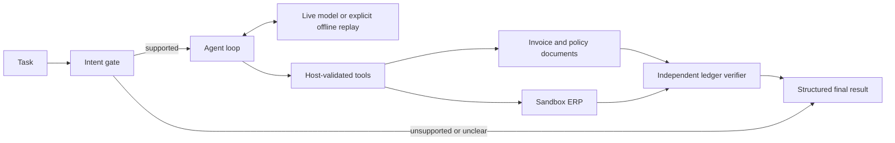

# CentrAlign Operator

CentrAlign Operator is a local accounts-payable prototype. A bounded tool-calling agent reads synthetic invoice files and one procurement policy, works through a local sandbox ERP, waits for approval when the policy requires it, and checks the saved ledger row before reporting a successful invoice entry.

The app is a demo environment. Its ERP, company memory, vendors, invoices, credentials, and ledger are synthetic. It does not connect to a real finance system and cannot pay invoices or send email.

## Setup and run

Requirements: Python 3.10 or newer, the packages in `requirements.txt`, and the Playwright Chromium browser.

```bash
python3 -m pip install -r requirements.txt
python3 -m playwright install chromium
```

### Offline replay demo

Offline replay is a **scripted test double**, not a live language model. Start it explicitly:

```bash
python3 web_app.py --offline
```

Open [http://127.0.0.1:8765](http://127.0.0.1:8765). The page labels the selected planner as **FakeLLM · offline replay**. The replay uses a fixed local sequence to exercise the supported workflow; it does not demonstrate live model reasoning. Start with a fresh ledger using `python3 web_app.py --offline --reset-demo-data`. The UI also has a **Reset demo data** button. Reset clears ledger rows and run history while preserving inbox files and policy.

To keep the demo data separate from the checked-in fixtures, pass a data directory:

```bash
python3 web_app.py --offline --data-dir /tmp/centralign-operator
```

### Live providers

Live runs require the API key for the selected provider. They do not switch to offline replay. Copy `.env.example` to `.env`, fill in the one provider key you want to use, then export the settings in the current shell before starting the server:

```bash
cp .env.example .env
# Edit .env and set the selected provider's API key.
set -a
source .env
set +a
python3 web_app.py
```

For example, Groq with an OpenAI-compatible `gpt-oss` model:

```dotenv
CENTRALIGN_PROVIDER=groq
GROQ_API_KEY=your_groq_key
CENTRALIGN_GROQ_MODEL=openai/gpt-oss-20b
```

Alternatively, set `CENTRALIGN_PROVIDER=gemini` with `GEMINI_API_KEY`, or `CENTRALIGN_PROVIDER=openai` with `OPENAI_API_KEY`. The provider-specific model variables are `CENTRALIGN_GROQ_MODEL`, `CENTRALIGN_GEMINI_MODEL`, and `CENTRALIGN_OPENAI_MODEL`; `CENTRALIGN_MODEL` is a general override. Groq’s current code default is `openai/gpt-oss-20b`, Gemini’s is `gemini-2.5-flash-lite`, and OpenAI’s is `gpt-4o`. The model can be changed to one enabled for your account. OpenRouter is also supported with `OPENROUTER_API_KEY` and `CENTRALIGN_OPENROUTER_MODEL`.

At most one live fallback is used, and only when `CENTRALIGN_FALLBACK_PROVIDER` names a separately configured provider. For temporary HTTP 429/503 limits, the client reads `Retry-After` or a `retry in Ns` message, caps the wait at 60 seconds, and otherwise uses exponential backoff with jitter. It retries the same provider up to four times after the initial attempt. A hard daily token-quota error skips those waits and tries the configured live fallback immediately. A live run with no usable provider stops with an error; it never becomes a replay run.

**Keep `.env` local.** Do not commit API keys. The app sends the task and selected observations to the configured provider. ERP credentials, approval tokens, and host-computed source hashes are kept on the local host.

### macOS SSL certificate note

If Python reports a certificate verification error on macOS, check the certificate setup for that Python installation. For a Python.org framework installation, run its matching `Install Certificates.command` from `/Applications/Python 3.x/`. Do not disable TLS certificate verification.

## Architecture



### Agent loop

For a supported task, the host classifies the request and applies a separate deterministic check to the original wording. The bounded agent loop sends the current task, recent observations, compact host-owned run state, and available tool schemas to the selected provider. The model chooses the next tool and any recovery action. The host validates each call, executes it, records an observation, and asks the model what to do next. A run ends through `finish`; invoice-entry runs can finish successfully only after the ERP ledger has been read back and verified. Unsupported or ambiguous intent-gate results are finalized by the host without an additional model turn.

### Safety layers

- **LLM capability classifier:** identifies requested actions and maps them to supported capabilities or `unsupported`.
- **Deterministic verb guard:** independently requires an explicit record/enter/post/log verb and rejects recognized unsupported actions before write tools are made available.
- **Human approval gate:** blocks writes above the configured currency threshold until a person approves the run.
- **Single-use, invoice-bound token:** the host creates a short-lived approval token for the approved invoice and submits it to the ERP; the model cannot supply it.
- **Route and selector allowlists:** browser tools can operate only on the local ERP routes and approved controls.
- **Untrusted document handling:** invoice text is treated as data, known instruction-like lines are flagged and removed from model-facing text, and amount/date/vendor fields come from structured parsing.
- **Independent verification:** the host reads the ERP ledger row and compares its fields with the selected parsed invoice before returning `complete`.

These checks reduce risk in this narrow demo. The prompt-injection detector is heuristic and is not a complete defense.

### Model and host responsibilities

| The model chooses | The host owns |
|---|---|
| The next tool call, invoice candidate, and recovery after an observation | Login and credentials from company memory |
| A sequence of permitted actions, with results observed between writes | Route/selector checks, policy checks, and write authorization |
| A selection reason and invoice-entry intent to be checked | Source parsing, provenance filename/hash, and approval token lifecycle |
| A finish request | Ledger read-back verification and final evidence |

The host does not let a model-provided summary or invoice amount substitute for its parsed invoice and ledger evidence.

## Design decisions

- **Host-managed login, tokens, and hashes:** credentials, approval secrets, and SHA-256 computation are capabilities the model does not need. Keeping them on the host avoids asking a model to invent or repeat sensitive values and gives the host the source provenance it can verify.
- **Independent verification:** a successful submit response alone does not prove what was saved. The verifier reads the ERP ledger and checks the source fields before the host reports completion.
- **Layered intent checks:** the LLM classifier can interpret wording and list requested capabilities; the deterministic guard is a separate check that locks writes when an explicit entry verb is absent or a recognized unsupported verb is present.
- **Sandbox ERP:** a local ERP provides realistic page navigation, form validation, approval, and ledger read-back without touching a real finance system.
- **Explicit replay mode:** `--offline` runs a scripted FakeLLM test double for repeatable local demonstrations. The UI and API identify it as `offline-replay`; it is not an automatic fallback for live calls.
- **Why DOM selectors instead of vision computer use:**
  - *Deterministic, faster, cheaper (tokens), testable without a GPU / display server.*
  - Vision computer use is powerful for arbitrary desktop GUIs, but web enterprise applications possess well-structured DOMs. CentrAlign interacts directly via DOM selectors for speed, lower token overhead, and execution reliability, pairing it with host-side ledger verification so the agent cannot hallucinate that an ERP write succeeded.
  - *The trade-off:* DOM selectors can be brittle to page restructuring. CentrAlign mitigates this through a strict selector allowlist, semantic helpers (`browser_fill_form`), and defensive DOM validation.
- **Generalization to other enterprise workflows:**
  - The core architecture—combining a bounded agent loop with layered intent guards, an external policy engine, single-use action tokens, and independent ledger verification—directly transfers to other high-stakes enterprise agent workflows, such as CRM lead/opportunity entry, customer ticket resolution, and ERP sales-order processing.

## Models, APIs, and frameworks

| Component | Role |
|---|---|
| Python | Agent runtime, API, and local tools |
| FastAPI and Uvicorn | Operator API and sandbox ERP pages |
| Playwright | Browser interaction and ERP DOM verification |
| pypdf | Extract text from invoice PDFs |
| SQLite | Local ledger, run history, and audit events |
| Groq chat-completions adapter | Live provider; verified with `openai/gpt-oss-20b` |
| Gemini adapter | Google AI Studio API; implemented, not live-verified for this submission |
| OpenAI adapter | OpenAI Chat / Responses API; implemented, not live-verified for this submission |
| OpenRouter adapter | OpenAI-compatible chat completions; implemented |

### Manual verification

The live Groq workbench was manually verified with a high-value Acme invoice: it requested approval, submitted `INV-2026-2116` (INR 68,500) after approval, and verified the saved ledger row. Other live UI checks covered the unsupported payment/email refusal, a read-only ledger question, the August Acme invoice, instruction-like invoice text, and clarification when the vendor was omitted. Full automated live batches were rate-limit-limited; the production folder does not include the evaluation harness.

### Failure modes the safety layers are designed to catch

1. **Unapproved high-value writes:** Blocked by the policy engine and single-use host approval token. The agent cannot forge approval.
2. **Unsupported actions (e.g. paying invoices, emailing vendors):** Blocked by the capability classifier and deterministic verb guard before any browser write tool can be invoked.
3. **Prompt injection via invoice content:** Instruction-like lines embedded inside invoice text are heuristically detected and stripped, and core invoice fields are extracted via structured parsing rather than model summary.
4. **Incorrect invoice selection:** Enforced by candidate inspection rules (`latest_by_invoice_date`, explicit month/number matching).
5. **False completion / hallucinated writes:** Blocked by independent Playwright DOM verification of the ERP ledger table against the source invoice fields.

The project depends on Python packages listed in `requirements.txt`. It does not use a frontend framework; the workbench is HTML, CSS, and JavaScript in `web/`. Follow [DEMO.md](DEMO.md) for the offline replay walkthrough and the live-provider walkthrough.

## Demo data and reset

The checked-in inbox contains synthetic PDF and TXT invoices. The two canonical Acme PDFs are `INV-2026-2084` (August, INR 42,000) and `INV-2026-2116` (October, INR 68,500). Stale Acme TXT copies with conflicting invoice numbers and amounts were removed. The other TXT fixtures cover Northstar, Vertex, and an instruction-like line. `data/policies/procurement_policy.txt` is the single policy source for approval thresholds and approved vendors. On first startup, the host creates `data/policies/company_memory.md` locally with vendor-directory information and a random sandbox password; this local file is ignored by Git and is not exposed to the model.

## Known limitations

- The supported write workflow is invoice entry only.
- Invoice extraction supports PDF and TXT documents with the expected labeled fields.
- Browser control is limited to one sandbox ERP with fixed routes and selectors.
- Live runs can take several minutes. Provider rate limits, daily token quotas, and network delays can interrupt a run; configure a fallback provider when available.
- Open models sometimes return malformed or schema-invalid tool calls. The host feeds recoverable validation feedback back to the provider, but a run can still stop for input/review.
- The deterministic unsupported-verb list can miss synonyms or indirect wording.
- The intent classifier is an LLM; the deterministic guard is an additional check, not a complete language-understanding system.
- Cross-run memory is limited. Ledger and run records persist locally; pending conversational follow-up context is in memory and expires after ten minutes.
- The app cannot make payments, send email, or operate on real ERP systems.
- Prompt-injection defense uses heuristic detection, line removal, and structured field parsing; it is not complete.

## Assumptions

- Invoice and policy fixtures are synthetic and suitable for a local demo.
- The user reviews and decides every requested human approval.
- “Record,” “enter,” “post,” and “log” indicate invoice entry only when the host guard also finds no recognized unsupported action.
- Live API keys are supplied through environment variables and kept outside version control.

## What I would build next

- Generic form and page understanding beyond the fixed ERP selectors.
- Vision-based computer use for layouts without stable DOM controls.
- Persistent, permissioned company memory across sessions.
- Scheduled invoice intake and review.
- Broader evaluation sets for intent, extraction, injection, and provider-specific tool calling.
- A hosted demo with isolated tenant data and explicit operational controls.

## Repository map

| File | Responsibility |
|---|---|
| `agent_loop.py` | Bounded observe/decide/execute loop, intent/write gates, tools, retries, run state, and final results. |
| `llm_clients.py` | Provider adapters, retry/fallback policy, and explicit offline FakeLLM replay. |
| `browser_tools.py` | Playwright session, route/selector allowlists, snapshots, and ledger verification. |
| `documents.py` | Confined inbox access, PDF/TXT parsing, candidate listing, and source hashes. |
| `policy.py` | Procurement policy parsing and threshold checks. |
| `company_app.py` | SQLite ledger, run/audit persistence, vendor directory, and policy access. |
| `web_app.py` | FastAPI workbench API, approval broker, and local ERP pages. |
| `worker.py` | Public agent entry point and CLI delegation. |
| `web/` | HTML, CSS, and JavaScript workbench. |
| `data/inbox/` and `data/policies/` | Synthetic demo invoices, policy, and sandbox company memory. |
| `.env.example` | Template for local provider configuration; copy to `.env` and keep the latter private. |
| `.gitignore` | Excludes local credentials, generated company memory, databases, and run data. |
